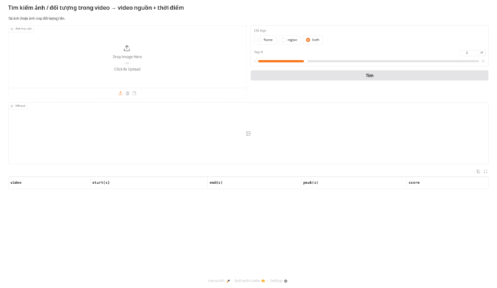
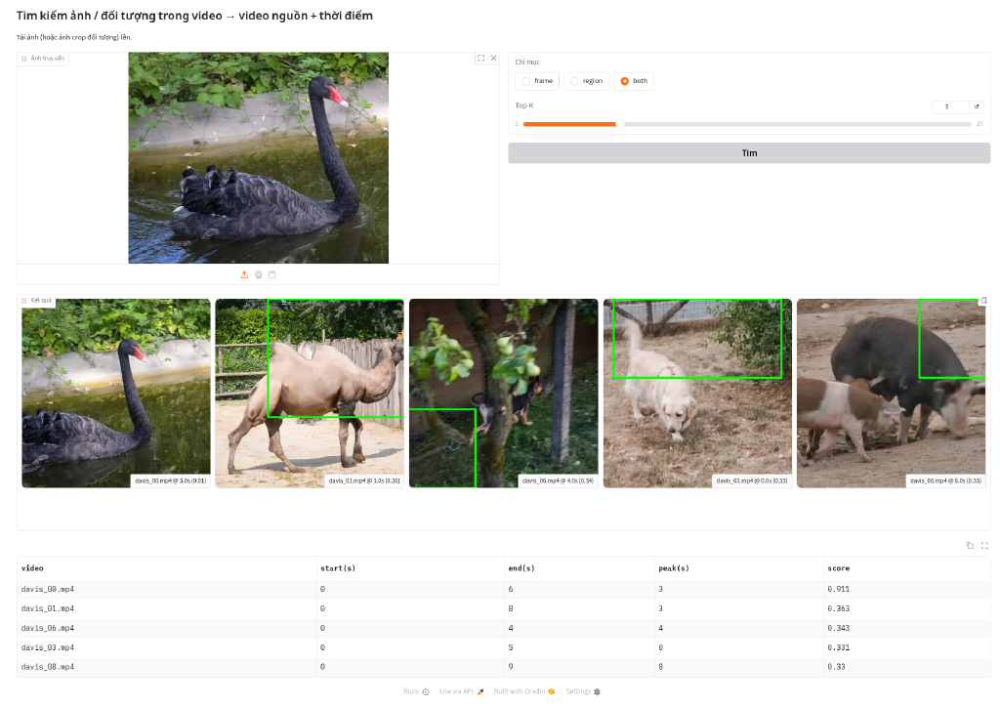

# Đề 12 – Tìm kiếm ảnh / đối tượng trong video (DINOv3 + FAISS, SAM 3.1 re-rank)

Đầu vào là **một ảnh truy vấn**, có thể là cả khung cảnh hoặc ảnh crop một đối tượng. Đầu ra là danh sách **(video nguồn, đoạn [start, end], thời điểm đỉnh, điểm)**. Bài toán tương ứng với *Instance Search* (TRECVID INS) / *known-item search* (VBS) ở quy mô nhỏ.

Pipeline: lấy mẫu khung (đều theo fps, tuỳ chọn lọc trùng **aHash** theo ý tưởng DigUp) → đề xuất vùng (**lưới đa tỉ lệ** | OWLv2 | **SAM 3 / 3.1**) → embedding (**DINOv3 ViT-S/16**; DINOv2 / CLIP / SigLIP 2 để so sánh, qua cùng giao diện `Embedder`) → hai chỉ mục **FAISS IndexFlatIP** (`frame` và `region`) → truy vấn `frame` | `region` | `both` (= max theo (video, t)) → **gộp hit liền kề** thành đoạn thời gian → (tuỳ chọn) re-rank top-20 bằng vùng lưới hoặc SAM 3.

## Trạng thái (24/10/2026)
| Hạng mục | Trạng thái |
|---|---|
| Pipeline CPU (lấy mẫu, lưới, DINOv3/DINOv2/CLIP, FAISS, gộp đoạn) | Chạy được, đã đo trên DAVIS 2017 (10 và 70 video) |
| Demo Gradio `app.py` | Chạy thật trên CPU box (24/10/2026) |
| SAM 3.1 trên CPU | Cài được (đã vá `device="cuda"`), nhưng bị OOM-kill (RSS ≈ 7.2 GB) → **chưa có số** |
| SAM 3.1 region / re-rank trên GPU | Kernel Kaggle T4 đã chạy xong, **số đo (VRAM, tốc độ, R@1/mAP@10) đang chờ tải về** (API Kaggle trả HTTP 429) → **chưa xác định** |
| OWLv2 region | Có mã, **chưa test** |
| EmbeddingGemma 2 | Chỉ đánh giá qua DigUp (truy vấn văn bản); **chưa tích hợp** vào pipeline của repo |

## Kết quả đo (box CPU 8 lõi dùng chung, 23/10/2026)
Số gốc: `results/RESULTS.md`, `results/*.json`, `results/eval_log.txt`, `results/eval_large_log.txt`.

**Benchmark tự dựng từ DAVIS 2017 val** (`scripts/prepare_davis.py`): 30 sequence ghép thành 10 video mp4 (24 fps, 854×480), lấy mẫu 1 fps = 73 khung. Region = lưới 2×2 + 3×3 (13 vùng/khung). 12 khung đầu mỗi sequence không đưa vào video; khung 0 dùng làm truy vấn, nên không rò rỉ. Một đoạn trả về là đúng nếu cùng video và chồng lấn đoạn GT (±0.5 s); mỗi GT chỉ khớp một lần.

Bộ truy vấn:
- `object`: 58 crop đối tượng (bbox mask +15%).
- `object_small`: 35 crop có mask < 5% khung.
- `object_hard`: 58 crop bị lật, thu 50%, tối 0.7 và dán lên nền nhiễu (`scripts/make_hard_queries.py`).
- `scene`: 30 khung đầy đủ.

### A. Truy vấn khó (`object_hard`, n = 58, 10 video)
| Encoder | Index | R@1 | R@5 | mAP@10 | Đỉnh top-1 ∈ GT |
|---|---|---|---|---|---|
| CLIP ViT-B/32 (baseline) | frame | 0.534 | 0.793 | 0.659 | 0.431 |
| CLIP ViT-B/32 | region | 0.293 | 0.707 | 0.475 | 0.241 |
| CLIP ViT-B/32 | both | 0.293 | 0.741 | 0.478 | 0.241 |
| DINOv2-small | frame | 0.759 | 0.983 | 0.848 | 0.759 |
| DINOv2-small | region | 0.759 | 0.983 | 0.807 | 0.724 |
| DINOv2-small | both | 0.759 | 0.983 | 0.813 | 0.724 |
| DINOv3 ViT-S/16 | frame | 0.724 | 0.983 | 0.814 | 0.707 |
| DINOv3 ViT-S/16 | region | 0.759 | 0.966 | 0.832 | 0.759 |
| **DINOv3 ViT-S/16** | **both** | **0.776** | 0.966 | **0.844** | **0.776** |

### B. Bộ lớn có distractor: 70 video (10 val + 60 video DAVIS 2017 train không chứa đối tượng truy vấn), 276 khung @1 fps
| Cấu hình | object_hard R@1 | object_hard mAP@10 | object R@1 | object mAP@10 |
|---|---|---|---|---|
| CLIP B/32 frame (baseline) | 0.190 | 0.298 | 0.862 | 0.876 |
| DINOv3-S/16 frame | 0.552 | 0.644 | 0.862 | 0.907 |
| DINOv3-S/16 region (grid) | 0.586 | 0.680 | 0.966 | 0.957 |
| **DINOv3-S/16 frame+region** | **0.586** | **0.680** | **0.966** | **0.957** |

Thời gian index (CPU dùng chung, load ≈ 26): CLIP frame 276 vector mất 1305 s; DINOv3 frame+grid 3864 vector mất 1237 s (≈ 0.22 khung/s). Truy vấn: CLIP 138–1593 ms, DINOv3 127–220 ms (embed + FAISS + gộp đoạn).

### C. Đối tượng nhỏ và bộ dễ (10 video), R@1 / mAP@10
| Encoder | Query | frame | region | both |
|---|---|---|---|---|
| CLIP B/32 | object_small (35) | 0.886 / 0.921 | 0.829 / 0.898 | 0.829 / 0.898 |
| DINOv2-small | object_small (35) | 0.943 / 0.971 | 0.971 / 0.986 | 0.971 / 0.986 |
| DINOv3 ViT-S/16 | object_small (35) | 0.971 / 0.986 | 1.000 / 1.000 | 1.000 / 1.000 |
| CLIP B/32 | object (58) | 0.931 / 0.932 | 0.897 / 0.919 | 0.897 / 0.919 |
| DINOv2-small | object (58) | 0.966 / 0.963 | 0.983 / 0.971 | 0.983 / 0.971 |
| DINOv3 ViT-S/16 | object (58) | 0.983 / 0.971 | 1.000 / 0.980 | 1.000 / 0.980 |
| CLIP B/32 | scene (30) | 0.967 / 0.983 | 1.000 / 1.000 | 1.000 / 1.000 |
| DINOv2-small | scene (30) | 1.000 / 1.000 | 1.000 / 1.000 | 1.000 / 1.000 |
| DINOv3 ViT-S/16 | scene (30) | 0.967 / 0.983 | 1.000 / 1.000 | 1.000 / 1.000 |

R@10 = 1.0 ở mọi cấu hình của bộ 10 video (chỉ có 10 video), nên không dùng để so sánh.

### D. Nhận xét
1. **DINOv3 + index region (`both`) tốt nhất trên bộ khó**: R@1 0.776 / mAP 0.844 so với CLIP frame 0.534 / 0.659. Khi thêm 60 video distractor, khoảng cách tăng lên: 0.586 so với 0.190.
2. Với CLIP, crop vùng lưới **làm giảm** kết quả (embedding toàn cục bị nhiễu bởi crop cắt ngang). Với DINO, region giúp ở đối tượng nhỏ và bộ khó, nên region dùng DINO.
3. Hạn chế: mỗi đối tượng chỉ có trong một sequence (truy vấn cùng cảnh, khác thời điểm), nên benchmark dễ hơn thực tế. Tốc độ CPU đo trên box quá tải nên chậm hơn thực tế nhiều; cần đo lại trên T4.

### E. Chạy thử app (24/10/2026, CPU)
Truy vấn ảnh thiên nga đen trên kho 10 video DAVIS (DINOv3-S, region lưới): top-1 là `davis_00.mp4`, đoạn 0.0–6.0 s, đỉnh 3.0 s, điểm 0.911; GT của đối tượng này trong video là 2.4–3.9 s. Các video khác chỉ đạt 0.33–0.36. Mỗi truy vấn ≈ 0.8 s.

## Phân tích DigUp (chi tiết: `digup_eval/digup_analysis.md`)
Đã chạy thật DigUp 0.7.0-beta.3 (MIT, https://github.com/ARahim3/DigUp, commit `d6f1f48`) trên CPU box với 2 video Wikimedia Commons (28 s, CC BY-SA 4.0).
- **Kiến trúc**: engine Swift; EmbeddingGemma 2 (~740M, 768-d, text/ảnh/audio chung một không gian) qua llama.cpp, Q8_0 GGUF (865 MB, repo HF công khai, không cần token). ffmpeg lấy **1 khung mỗi 3 s**, **lọc trùng aHash 8×8** (lệch ≤ 4 bit thì bỏ), mỗi khung giữ lại mang khoảng [start, end]. Lưu SQLite + FTS5, tìm brute-force, không có FAISS/ANN. Chấm điểm z-score với `zGate` = 2.0 cộng điểm từ khoá.
- **Số đo**: index ≈ 5 phút cho 9 vector (≈ 30 s/vector trên CPU); truy vấn văn bản nguội 29.6–33.3 s, dịch vụ ấm 8.8–12.3 s để embed câu truy vấn.
- **Phát hiện**: kết quả ban đầu đúng là nhờ **tên file**; đổi tên file thì `zGate` mặc định trả về rỗng trên kho nhỏ/đồng nhất. Với `--zgate -10`, "zebra" đạt cos 0.779 / 0.754 so với 0.562 / 0.528 cho truy vấn không liên quan.
- **Điểm yếu với Đề 12**: **không có truy vấn bằng ảnh**, chỉ embed toàn khung (70 vision token/khung), không có vùng vật thể, chậm trên CPU, không có ANN.
- **Quyết định**: **mượn ý tưởng, không dùng làm nền**. Repo này mượn lọc trùng aHash (`--dedup`) và đoạn thời gian theo khung. Muốn lấy mẫu 1 khung/3 s như DigUp thì đặt `--fps 0.333` (mặc định của repo là 1 fps).

## Công nghệ
| Thành phần | Model / phiên bản | Thư viện | License | Lý do | Link |
|---|---|---|---|---|---|
| Encoder chính (lõi) | DINOv3 ViT-S/16 LVD-1689M (CLS ⊕ mean patch bỏ 4 register token, 768-d, 224×224) | transformers 5.20.2 | **DINOv3 License** (gated) | Đặc trưng instance/dense SOTA, nhỏ, chạy CPU | https://huggingface.co/facebook/dinov3-vits16-pretrain-lvd1689m · https://github.com/facebookresearch/dinov3 |
| Region / re-rank (lõi GPU) | SAM 3 / SAM 3.1 (`sam3.1_multiplex.pt`), repo commit 7f473cf | `sam3` (Meta) + `scripts/sam3_cpu.patch` | **SAM License** (gated) | Phân đoạn theo khái niệm/exemplar, tracking | https://github.com/facebookresearch/sam3 · https://huggingface.co/facebook/sam3.1 |
| Encoder so sánh | DINOv2-small | transformers | Apache 2.0 | Stand-in không gated | https://huggingface.co/facebook/dinov2-small |
| Baseline | CLIP ViT-B/32 | transformers | MIT | Baseline chuẩn | https://huggingface.co/openai/clip-vit-base-patch32 |
| Encoder tuỳ chọn | SigLIP 2 base (`google/siglip2-base-patch16-224`) | transformers | Apache 2.0 | Có sẵn trong `Embedder`, chưa đo | https://arxiv.org/abs/2502.14786 |
| Region tuỳ chọn | OWLv2 (`google/owlv2-base-patch16-ensemble`, objectness top-8) | transformers | Apache 2.0 | Open-vocab, chạy T4; chưa test | https://arxiv.org/abs/2306.09683 |
| Region CPU | Lưới 2×2 + 3×3, overlap 25% | tự cài | – | Không cần GPU | |
| Chỉ mục | FAISS IndexFlatIP | faiss-cpu 1.15.1 | MIT | Chính xác, đủ nhanh ở quy mô này | https://github.com/facebookresearch/faiss |
| Tham khảo | DigUp + EmbeddingGemma 2 | llama.cpp | MIT / Apache 2.0 | Phân tích, mượn aHash + lấy mẫu | https://github.com/ARahim3/DigUp · https://huggingface.co/google/embeddinggemma-2 |
| Video / UI | OpenCV 5.0.0.93, Gradio 6.30.0 | | Apache 2.0 | Đọc video, demo | |
| Dữ liệu | DAVIS 2017 trainval 480p | | Annotation CC BY 4.0 | GT thời gian từ mask | https://davischallenge.org/davis2017/code.html |
| Runtime | Python 3.13.5 (mã tương thích 3.12 theo đề), torch 2.14.1+cpu | | | | |

Thay đổi công nghệ: bỏ `open_clip_torch` (xung đột torchvision), dùng CLIP qua Transformers; DINOv2-small chỉ là stand-in lúc DINOv3 bị 403, sau khi được cấp quyền DINOv3 thành encoder chính; SAM 3.1 chuyển sang GPU Kaggle vì OOM trên CPU. Khảo sát đầy đủ: `research.md`.

## Cài đặt
```bash
git clone https://github.com/meiiie/tgmt-de12-video-image-search && cd tgmt-de12-video-image-search
python -m venv .venv && . .venv/bin/activate
pip install -r requirements.txt            # + torch bản CPU/GPU phù hợp
export HF_TOKEN=...                        # token HF của bạn, đã được cấp quyền DINOv3 (và SAM 3.1 nếu dùng); KHÔNG commit
# tuỳ chọn SAM 3/3.1:
git clone https://github.com/facebookresearch/sam3 && (cd sam3 && git checkout 7f473cf && git apply ../scripts/sam3_cpu.patch && pip install -e .)
```

## Chạy nhanh
```bash
# 1. Dữ liệu benchmark (DAVIS 2017 trainval 480p, ~833 MB)
wget https://data.vision.ee.ethz.ch/csergi/share/davis/DAVIS-2017-trainval-480p.zip && unzip DAVIS-2017-trainval-480p.zip -d data
python scripts/prepare_davis.py && python scripts/make_hard_queries.py

# 2. Lập chỉ mục (thêm --dedup 4 để lọc trùng aHash, --fps 0.333 để lấy 1 khung/3 s)
python scripts/build_index.py --videos data/davis_bench/videos --out data/idx_dinov3-vits16 \
  --model facebook/dinov3-vits16-pretrain-lvd1689m --regions grid

# 3. Truy vấn một ảnh
python scripts/query.py --index data/idx_dinov3-vits16 --image q.jpg --mode both --k 5

# 4. Đánh giá (R@1/R@5/mAP@10); --rerank grid|sam3 để re-rank top-20
python scripts/evaluate.py --index data/idx_dinov3-vits16 --queries data/davis_bench/queries_object_hard.json

# 5. Demo Gradio
python app.py --index data/idx_dinov3-vits16 --videos data/davis_bench/videos           # http://localhost:7860
python app.py --index data/idx_dinov3-vits16 --videos data/davis_bench/videos --share   # Colab/Kaggle: link *.gradio.live
```
`--regions` nhận `none | grid | owlv2 | sam3`. Toàn bộ bảng kết quả: `scripts/run_all_evals.sh` (10 video) và `scripts/run_large.sh` (70 video, distractor thêm bằng `scripts/add_distractors.py`).

## Kaggle / Colab GPU
- Colab/Kaggle: `notebooks/de12_colab.ipynb`, đặt `HF_TOKEN` qua Secrets.
- Kernel Kaggle private `holilihu/tgmt-de12-video-image-search` (`kaggle/`, T4): không dùng secret; trọng số DINOv3 và SAM 3.1 (chia phần, kiểm sha256) đọc từ dataset private qua `/kaggle/input`. Thiếu trọng số thì ghi `results/STATUS.txt` và dừng. Đo GPU bằng `scripts/gpu_bench.py`. Đẩy kernel: `kaggle kernels push -p kaggle/ -t 7000`. Chi tiết: `kaggle/README.md`.
- Giới hạn Kaggle: tối đa 2 phiên GPU đồng thời mỗi tài khoản; CLI không gắn được secret.

## Ảnh chụp màn hình



## Cấu trúc repo
```
vsearch/core.py           lấy mẫu khung, aHash dedup, vùng, Embedder, build_index, Searcher, merge_segments
vsearch/sam3_regions.py   đề xuất vùng SAM 3 (text prompt)
vsearch/rerank.py         re-rank top-K bằng vùng lưới / SAM 3
vsearch/weights.py        dò layout trọng số offline (Kaggle)
scripts/                  prepare_davis, make_hard_queries, add_distractors, build_index, query, evaluate, gpu_bench, run_*.sh, sam3_cpu.patch
app.py                    demo Gradio
notebooks/de12_colab.ipynb, kaggle/   chạy GPU
results/                  số đo thật (RESULTS.md, *.json, log)
digup_eval/               đánh giá DigUp
research.md               khảo sát SOTA + lựa chọn công nghệ
```

## Dữ liệu & giấy phép
- **DAVIS 2017** (https://davischallenge.org/davis2017/code.html): annotation CC BY 4.0; nguồn video gốc liệt kê trong SOURCES.md của gói. Repo không chứa dữ liệu, video hay trọng số.
- Distractor 60 video DAVIS 2017 train: `results/licenses_distractors.md`.
- Video thử DigUp: Wikimedia Commons, CC BY-SA 4.0 (`digup_eval/digup_analysis.md`).
- SAM 3 / 3.1: **SAM License** của Meta, trọng số gated, không phân phối lại.

## Built with DINOv3
Dự án này dùng DINOv3 (`facebook/dinov3-vits16-pretrain-lvd1689m`) của Meta theo **DINOv3 License** (https://ai.meta.com/resources/models-and-libraries/dinov3-license/). Khi phân phối trọng số hoặc sản phẩm phái sinh phải kèm license và ghi "Built with DINOv3"; công bố kết quả phải ghi nhận việc dùng DINOv3. Repo không phân phối trọng số DINOv3.

## Trích dẫn
- O. Siméoni et al., "DINOv3", arXiv:2508.10104, 2025.
- N. Carion et al., "SAM 3: Segment Anything with Concepts", arXiv:2511.16719, 2025; SAM 3.1 release notes: https://github.com/facebookresearch/sam3/blob/main/RELEASE_SAM3p1.md
- M. Oquab et al., "DINOv2", arXiv:2304.07193, 2023.
- A. Radford et al., "CLIP", arXiv:2103.00020, 2021.
- M. Tschannen et al., "SigLIP 2", arXiv:2502.14786, 2025.
- M. Minderer et al., "Scaling Open-Vocabulary Object Detection" (OWLv2), arXiv:2306.09683, 2023.
- M. Douze et al., "The Faiss library", arXiv:2401.08281, 2024.
- J. Pont-Tuset et al., "The 2017 DAVIS Challenge on Video Object Segmentation", arXiv:1704.00675, 2017.
- DigUp, https://github.com/ARahim3/DigUp (MIT).
