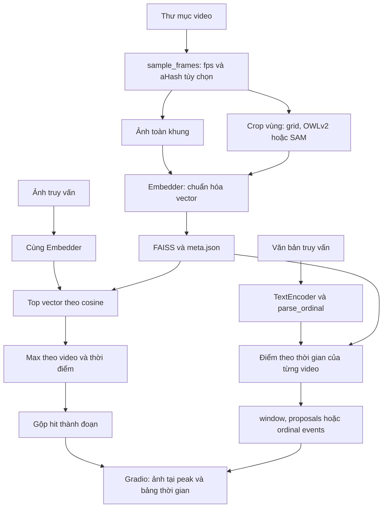

# Phân tích logic Đề 12

**Cập nhật sau khảo sát:** FrameAtlas đã triển khai ứng dụng desktop trong `desktop/`. Các lỗi temporal tái hiện bên dưới đã được sửa và kiểm tra hồi quy; xem [bằng chứng kiểm thử](desktop-verification.md). Phần phân tích dưới đây giữ nguyên mốc source ban đầu để đối chiếu. Các hạn chế về metadata, dependency và notebook của pipeline nghiên cứu không mô tả backend desktop mới.

Phạm vi là source tại `be13268a60a72d812dfd8105350fe8fc6ddec3dd`, khảo sát ngày 01/11/2026. Đây là bước chuẩn bị cải thiện. Code thuật toán trong `vsearch/` chưa thay đổi ở mốc này.

## Bài toán và trạng thái thực tế

Theo README, đầu vào chính là ảnh toàn cảnh hoặc ảnh crop đối tượng. Đầu ra là video nguồn, khoảng `start` đến `end`, thời điểm `peak_t`, điểm và bbox nếu có. Tìm bằng văn bản tiếng Việt/Anh là phần mở rộng đã có code.

Repo đã có pipeline, Gradio, notebook Colab/Kaggle và nhiều báo cáo thí nghiệm. Không phải skeleton cần xây lại. Chưa tìm thấy `de_bai.pdf` trong checkout, dù `research.md` dẫn tài liệu này. Chưa thể xác nhận đầy đủ rubric môn học từ README thay cho đề gốc.

CLI `scripts/build_index.py` mặc định dùng `google/embeddinggemma-2`, chỉ frame, 1 fps. Hàm Python `build_index()` vẫn mặc định CLIP và grid. Gọi API trực tiếp và gọi CLI vì vậy tạo cấu hình khác nhau nếu bỏ tham số model/regions.

## Luồng dữ liệu

App hiện đọc một index và thư mục video có sẵn khi khởi động. Người dùng tải ảnh truy vấn; app chưa có bước tải video và lập index trực tiếp qua giao diện. Kết quả hiện là ảnh tại peak cùng bảng thời gian, chưa có video player nhảy đến đoạn.

## Các cấu trúc quyết định hành vi

| Cấu trúc | Ý nghĩa |
|---|---|
| `X: float32[N, D]` | Vector ảnh đã chuẩn hóa L2; inner product tương ứng cosine |
| `meta[i]` | `video`, `t`, `kind`, `box`; ID FAISS trỏ vào vị trí này |
| `meta.json` | Model, fps, regions, dedup, thống kê và toàn bộ metadata |
| `frame.faiss`, `region.faiss`, `region_sam.faiss` | Các nhóm vector dùng chung không gian embedding và ID metadata |
| Hit theo `(video, t)` | Giữ điểm lớn nhất giữa frame và vùng; không phải trung bình hay fusion học được |
| Segment | `video`, `start`, `end`, `peak_t`, `score`, và `box` với tìm ảnh |

`D` phụ thuộc model. DINO nối CLS và trung bình patch, bỏ register token. EG2 qua SentenceTransformer; CLIP/SigLIP dùng image features. Không được trộn index của các model chỉ vì có cùng chiều vector.

## Sampling, indexing và tìm ảnh

`sample_frames()` tại `vsearch/core.py:14` đọc tuần tự bằng OpenCV. Bước frame là `round(video_fps / requested_fps)`. Thời gian lưu theo chỉ số frame chia fps nguồn. FPS thực tế vì thế có thể lệch fps yêu cầu khi tỷ lệ không nguyên.

Lọc trùng aHash chỉ so với khung đã giữ gần nhất. Đây là cách giảm frame tương tự, không phải phát hiện ranh giới shot hoặc theo dõi danh tính vật thể.

`build_index()` tại `core.py:105` tạo một vector toàn khung và các vector crop nếu bật vùng. Grid mặc định có 13 vùng. FAISS dùng tìm chính xác `IndexFlatIP` bọc trong `IndexIDMap`. `meta` là hợp đồng nối vector với video, thời gian và bbox.

`Searcher.search()` tại `core.py:158` lấy tối đa 200 vector từ mỗi loại index, gộp bằng max theo `(video, t)`, rồi `merge_segments()` nối hit có khoảng cách tối đa `1.5 / fps`. Điểm đoạn bằng điểm lớn nhất của các hit.

Hệ quả cần đo trước khi cải thiện: ở kho nhỏ, top-200 có thể chứa gần như toàn bộ frame, kể cả điểm thấp. Các hit nối liên tiếp có thể tạo đoạn rất dài. Tìm đúng video hoặc overlap GT không đồng nghĩa xác định chính xác biên đoạn. Đây là hạn chế của thiết kế/metric, chưa phải bằng chứng model kém.

Biên đoạn ảnh và chữ hiện cũng khác nghĩa. `merge_segments()` lấy `end` bằng timestamp hit cuối, nên một hit đơn có `start == end`. Tìm chữ cộng thêm `1/fps` vào biên cuối. Khi bật dedup, khoảng cách giữa các frame giữ lại có thể lớn hơn ngưỡng gộp cố định. Cần thống nhất cách biểu diễn khoảng thời gian trước khi diễn giải IoU hoặc dựng video player.

## Tìm bằng chữ và thời gian

`Searcher.search_text()` tại `core.py:171` tái dựng matrix frame, mã hóa câu và tính cosine cho mọi frame. `parse_ordinal()` nhận các từ đầu tiên, thứ hai, thứ ba, cuối cùng cùng một số từ tiếng Anh.

- `window` làm mượt đường điểm và mở rộng quanh peak tới ngưỡng tương đối.
- `proposals` chấm nhiều cửa sổ theo trung bình bên trong trừ `1.5 * trung bình bên ngoài`, rồi NMS. Điểm này không phải cosine.
- Với từ thứ tự, bước đầu chọn video tốt nhất, sau đó `events_v2()` chọn sự kiện theo thời gian. Dedupe replay chỉ chạy khi cấu hình `dup` có giá trị; mặc định hiện là `None`.

Ngưỡng không tìm thấy luôn dùng điểm `window` trước khi chuyển sang proposals. App mặc định 0.637 với tên model chứa `embeddinggemma`; đó là ngưỡng hiệu chỉnh trong thí nghiệm cũ, không phải xác suất hay ngưỡng chung mọi miền. DINO không có text encoder nhưng UI hiện vẫn hiển thị ô tìm chữ.

## Lỗi đã tái hiện

Chạy `python scripts/audit_temporal.py`. Script gọi trực tiếp hàm hiện có với điểm số xác định, không tải model. Mỗi bất biến vi phạm làm báo cáo `passed=false`; exit code là 1 nếu còn lỗi.

| Mức | Trường hợp | Kết quả hiện tại | Nguyên nhân |
|---|---|---|---|
| P1 | 7 video, mỗi video 1 frame, điểm tăng từ 0.1 đến 0.99; yêu cầu top-1 | Chọn video `4.mp4` điểm 0.5. Đảo thứ tự metadata thì chọn đúng `6.mp4` điểm 0.99 | `text.py:114` dùng tổng `len(segs)` để dừng trong vòng lặp từng video, bỏ qua video phía sau |
| P1 | Một video có điểm `[0.9, 0.8, 0, 0.7, 0]`, `w=1` | Chỉ trả đoạn đầu, mất sự kiện riêng tại giây 3 | Cùng dòng 114 dùng `break` khi gặp frame đã thuộc đoạn trước, thay vì tiếp tục xét peak còn lại |
| P1 | Truy vấn thứ tự trên video chỉ có 1 frame, điểm 0.9 | `IndexError: list index out of range` | `events_v2()` có thể trả rỗng khi đường điểm phẳng, nhưng `text.py:92` vẫn đọc `ev[-1]` |

Lỗi đầu còn ảnh hưởng ngưỡng không tìm thấy và việc chọn video cho ordinal, vì `core.py:183` gọi `text_search(..., k=1)` trước. Do đó cần kiểm lại số liệu text multi-video trước khi dùng chúng để kết luận chất lượng model. Đánh giá Charades với video đã chỉ định không chịu lỗi bỏ các video phía sau theo cùng cách.

## Rủi ro phát hiện qua đọc code

Các mục dưới đây chưa được tái hiện đầy đủ tại thời điểm ghi nhận, cần kiểm tra trước khi sửa.

- `build_index()` chỉ ghi loại index đang có; không dọn file loại cũ nếu dùng lại cùng output directory. Rebuild từ grid sang frame-only có thể để `region.faiss` không khớp `meta.json` mới.
- `scripts/build_index_cached.py` khóa cache bằng basename video và `regions`, không có model, fps, hash video hay preprocessing. Dùng lại cache sau đổi cấu hình có thể trộn vector và metadata không tương thích.
- Thư mục video rỗng hoặc không giải mã được dẫn đến `np.concatenate([])`. FPS không dương cũng chưa được kiểm tại CLI.
- `scripts/evaluate.py` mặc định chạy cả `region` dù index mặc định EG2 chỉ có frame. Kết quả rỗng sau đó được truy cập bằng `segs[0]`.
- `requirements.txt` chỉ đặt cận dưới; chưa có lockfile. Cài mới không đảm bảo tái tạo phiên bản của benchmark đã lưu.
- Notebook `notebooks/de12_colab.ipynb` còn lệnh clone `<REPO_URL>` và chỉ cài trực tiếp `faiss-cpu gradio`. Đây là notebook cũ để so CLIP/DINOv2, chưa phải đường chạy EG2 mặc định đã được xác minh. Cần cập nhật setup và chạy lại notebook trước khi giao để Run all.
- Metadata chưa có fingerprint model revision, preprocessing, dtype, video và duration. App ước lượng duration từ frame cuối cộng `1/fps`, có thể khác thời lượng file.

## Đọc số liệu đúng phạm vi

DAVIS ghép clip từ các sequence; frame 0 làm query, 12 frame đầu không được ghi vào video. Điều này ngăn trùng chính xác frame query, nhưng cảnh gần nhau theo thời gian vẫn làm benchmark dễ hơn truy vấn khác nguồn.

Metric ảnh trong `scripts/evaluate.py` chấp nhận bất kỳ overlap nào với GT cộng tolerance 0.5 giây. Cần giữ metric cũ để so baseline và bổ sung temporal IoU khi muốn đánh giá biên đoạn. Không thay metric rồi gọi chênh lệch là cải thiện model.

Charades dùng video đã biết, đo temporal grounding; đó là bài toán khác tìm trên toàn kho video. Các con số hai benchmark không thể so trực tiếp. Chưa chạy lại bộ DAVIS 70 video hoặc Charades trong phiên khảo sát này.

## Thứ tự cải thiện đề xuất

1. Sửa ba lỗi temporal đã tái hiện. Giữ bất biến top-1 không phụ thuộc thứ tự video, không bỏ sự kiện độc lập và không crash khi thiếu sự kiện.
2. Xác lập hợp đồng index/cache. Rebuild cùng thư mục phải tương đương build mới; đổi model/fps/video phải làm mất hiệu lực cache cũ.
3. Chuẩn hóa setup và benchmark tái lập. Chốt môi trường theo đề gốc, lưu manifest và tách thời gian load model khỏi encode/search.
4. Đo lại baseline ảnh và chữ trên cùng dữ liệu, đồng thời kiểm tra biên đoạn. Chỉ sau đó mới thử sampling, model hoặc rerank khác.
5. Cải thiện luồng demo theo nhu cầu nộp bài: index video, truy vấn, xem đúng đoạn và xuất kết quả.

Các bước này giữ EG2 frame-only làm mặc định hiện có cho đến khi có bằng chứng mới đủ mạnh. Chưa có lý do từ khảo sát này để tự chuyển sang SAM, fusion, HNSW hay model lớn hơn.
